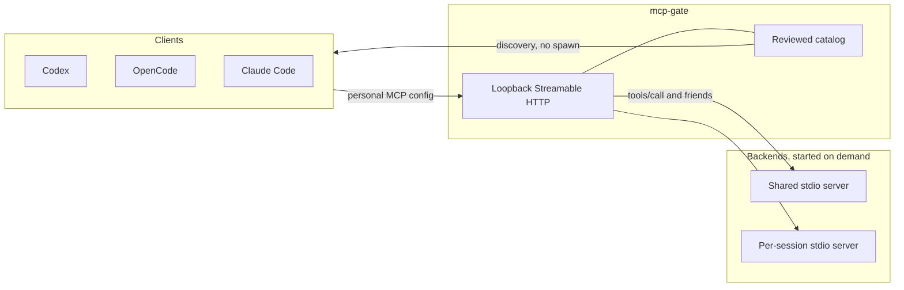

<p align="center">
  <picture>
    <source media="(prefers-color-scheme: dark)" srcset="docs/assets/mcp-gate-dark.svg">
    <source media="(prefers-color-scheme: light)" srcset="docs/assets/mcp-gate-light.svg">
    
  </picture>
</p>

<h1 align="center">mcp-gate</h1>

<p align="center">
  <em>Local Rust gateways for the stdio MCP servers you already run.</em>
</p>

<p align="center">
  <a href="https://www.npmjs.com/package/@matvei-radchenko/mcp-gate"></a>
  <a href="https://github.com/Matvey-Radchenko/mcp-gate/releases/latest"></a>
  <a href="https://github.com/Matvey-Radchenko/mcp-gate/blob/main/LICENSE"></a>
  <a href="https://github.com/Matvey-Radchenko/mcp-gate/actions/workflows/ci.yml"></a>
</p>

mcp-gate puts a small Rust gateway in front of each stdio MCP server you already use in Codex, OpenCode, Claude Code, or Claude Desktop. Clients see the tool list right away, but the real server process starts only when a tool is actually called. A reviewed stateless server can share one backend across all sessions; session-owned servers, such as browsers, get one per session and are closed when idle.

```sh
npx @matvei-radchenko/mcp-gate@latest setup
```

`setup` lists the connections it found, lets you pick some (nothing is selected by default), and shows a preview before it changes anything. Restart each affected app once afterwards. `remove` puts the direct connections back.


Keys: type to search, arrows move, Space selects, Enter reviews, Esc goes back.

## Why a gateway

A stdio MCP server configured in a client starts with every session, even when the session only needed the tool list. Three sessions and three servers mean nine processes. mcp-gate keeps one small gateway per server and starts backends only when they are used:


For example, one Telegram MCP backend (Java + TDLib) used about 400 MB on a maintainer's Mac. Without a gateway, every session that loads it starts its own copy, so five sessions come to about 2 GB (arithmetic, not a measurement). With mcp-gate it runs as one shared backend, and its gateway process uses about 14 MB. That is one observation, not a benchmark.

- **Lazy backends.** `initialize`, `tools/list`, and the rest of discovery are served from a reviewed catalog snapshot. The upstream process starts when a real call (`tools/call`, `resources/read`, `prompts/get`) needs it.
- **Shared or session-owned.** A reviewed stateless API can share one serialized backend across clients. A session-owned server (browsers, anything with per-client state) gets its own MCP connection. Shared mode is opt-in and is not safe for an arbitrary browser server.
- **Idle backends close.** [`idle_seconds`](docs/configurable-runtime.md#backend-idle-policy) defaults to 900 for session-owned backends and off for shared ones; `0` disables it. Only executable requests extend the timer. An open GET stream also keeps a session-owned recording alive. Shared non-Docker backends can opt in while keeping HTTP sessions open. When every slot is busy, `session_idle_evict_seconds` (default 120) lets the longest-idle session backend make room. Running calls are never evicted.
- **No automatic replay.** Actions are never retried or replayed. After a backend crash or a restart, sessions and unfinished work are not restored.
- **Managed client setup.** `setup` copies the binary into permanent versioned storage (independent of the npx cache), registers a user service (LaunchAgent on macOS, a systemd --user unit on Linux, or a logon Task Scheduler task on Windows), checks readiness, and then connects the selected client entries. Names and permission settings are preserved.
- **Yours to undo.** `remove` restores direct connections. It does not delete MCP packages, user data, logs, browser artifacts, or old releases.

You still install and update MCP packages, interpreters, Docker, and browsers. Setup's discovery runs the existing command, so `npx`, `uvx`, or Docker may download their own dependencies.

## Install

The command is `mcp-gate`; `@matvei-radchenko/mcp-gate` is only the npm package name. Installing or updating the package does not switch existing connections by itself: run `setup` from the build you want (an older build downgrades compatibly).

Release targets are **macOS ARM64**, **macOS Intel**, **Windows x64**, **Linux x64**, and **Linux ARM64**. Linux binaries require glibc 2.35 or newer (Ubuntu 22.04, Debian 12, Fedora 36, and later). musl-based systems such as Alpine are not supported.

<details>
<summary>npm (recommended)</summary>

```sh
npx @matvei-radchenko/mcp-gate@latest setup
npx @matvei-radchenko/mcp-gate@latest status
npx @matvei-radchenko/mcp-gate@latest remove
```

Or install the launcher globally. It also provides `adopt` and `idle`:

```sh
npm i -g @matvei-radchenko/mcp-gate
mcp-gate setup
```

The scoped packages are `@matvei-radchenko/mcp-gate` and the platform binaries `@matvei-radchenko/mcp-gate-bin-darwin-arm64`, `@matvei-radchenko/mcp-gate-bin-darwin-x64`, `@matvei-radchenko/mcp-gate-bin-win32-x64`, `@matvei-radchenko/mcp-gate-bin-linux-x64`, and `@matvei-radchenko/mcp-gate-bin-linux-arm64`.

</details>

<details>
<summary>GitHub Release binary</summary>

Download the archive for your platform from the [GitHub Releases](https://github.com/Matvey-Radchenko/mcp-gate/releases) page (`mcp-gate-*-darwin-arm64.tar.gz`, `*-darwin-x64.tar.gz`, `*-win32-x64.tar.gz`, `*-linux-x64.tar.gz`, or `*-linux-arm64.tar.gz`) and verify it against the attached `SHA256SUMS`. Put `mcp-gate` on your `PATH`, then run `mcp-gate setup`.

</details>

State lives in `~/Library/Application Support/mcp-gate`, `%LOCALAPPDATA%\mcp-gate`, or `~/.local/share/mcp-gate` (`$XDG_DATA_HOME/mcp-gate`). Gateways start after login; MCP backends stay lazy.

On Linux, setup registers a `systemd --user` unit under `~/.config/systemd/user` (or `$XDG_CONFIG_HOME/systemd/user`), with `WantedBy=default.target`. Units start with your user session after login. To keep the user manager — and those units — available after logout and at boot, run `loginctl enable-linger "$USER"`. If `systemd --user` is not reachable, setup leaves client configs unchanged and prints a manual fallback: prepare a private state directory and a config with absolute paths, then run `mcp-gate serve --config "/absolute/path/config.toml"`.

Run `setup` again with a newer or older build to update compatible background services. An idle service enters maintenance before replacement; a busy service waits until a later setup. Unsupported state formats are rejected. Operation journals keep recoverable changes and do not overwrite later edits.

After upgrading to this release, re-run `mcp-gate setup` once and restart the clients it lists. Setup moves Codex and Claude Code headers helpers from managed versioned paths to `current/mcp-gate` (`current\mcp-gate.exe` on Windows), including helpers on external connections. Future setup runs refresh that executable in place. OpenCode keeps using a file-backed Authorization header.

For a legacy user service, run `mcp-gate adopt <name>` once to record its identity. Then run `mcp-gate setup` with the official executable and select the adopted gateway. Use `setup --dry-run --json` to preview the migration. Setup points the service at `binaries/<version>-<sha256>/` and preserves its label, endpoint, credentials, backend, and service settings. Adoption saves no client bindings, so those connections stay `external`. Restart the client if setup migrated its headers helper. A subsequent setup leaves a gateway on the current managed binary running.

For unattended setup, select the external connection with the usual `--client`, `--server`, and `--yes` options. Setup matches the service by its endpoint. If the gateway has no matching client entry, use the adopted gateway name or service label as the `--server` value and supply `--client`.

## Everyday commands

| Command | What it does |
| --- | --- |
| `mcp-gate setup` | Preview and apply selected client connections, service updates, and adopted gateway migrations. |
| `mcp-gate status` | List client connections and `local.mcp-gate.*` user services (LaunchAgents on macOS, systemd --user units on Linux, and logon tasks on Windows). |
| `mcp-gate remove` | Restore selected connections, or all managed ones with `--all --yes`. |
| `mcp-gate adopt <name>` | Record an unmanaged `local.mcp-gate.<name>` user service in the local registry. Does not restart the gateway, edit client settings, or copy the binary. |
| `mcp-gate idle <name> [15m\|off]` | Show or set backend idle expiry. Use `--dry-run` to preview or `--yes` to save; prints the required gateway restart command. |
| `mcp-gate share <name>` | Review shareability advice and explicitly save shared backend ownership. Use `--dry-run` to preview. |
| `mcp-gate isolate <name>` | Restore per-session backend ownership. Restart the gateway to apply the change. |
| `mcp-gate connect <name> [--config <path>]` | Expose an existing local gateway to a stdio MCP client. |

**Setup and remove options**

- `--dry-run` previews the selected changes without starting a backend or writing files.
- `--client`, `--server`, and `--project` narrow the selection. `--project` matters when Claude Code has a project-scoped server.
- `--cwd <dir>` sets the working directory for selected connections that do not declare one. Without it, interactive setup asks; mcp-gate never guesses. For a global `npx` or `uvx` server that does not use project files, `--cwd "$HOME"` is a fine explicit choice.
- `--diff` shows the command, arguments, working directory, and gateway URL. Environment values, headers, and anything secret-like stay hidden.
- `--yes` skips prompts and requires an explicit client and server, except `remove --all --yes`.
- `--json` works before or after the subcommand and writes one versioned document to stdout. Diagnostics go to stderr.

**Status**

- `status --details` explains where each connection comes from. A direct connection shows `health not checked` until it has a gateway.
- `status --probe` asks a gateway to start its backend only when it has none and can safely pause; busy gateways are skipped.
- A `--server` or `--client` that matches nothing is an error.
- `external` means the client uses a gateway without saved direct settings. Setup can migrate a headers helper from this installation's binary store. Remove has no saved connection to restore.
- A healthy gateway does not prove that a running app has switched to it. Restart each affected app once after `setup`.

**Labels and sharing**

- New gateways get a readable service label, `local.mcp-gate.<name>`, or the next free `-2`, `-3`, … if it is taken. The preview shows the label before anything is registered.
- Installations from 0.1.0 keep their `local.mcp-gate.<uuid>` labels. `status`, `setup`, and `remove` still manage them, and they are not renamed.
- The same command, arguments, environment, and working directory in several clients share one gateway. Session mode still starts a separate backend per MCP connection, and a session-mode server is never attached to a shared-mode gateway.

Claude Code local scope can override a selected project through personal settings. Other project entries without a verified local override are skipped, as are commands whose environment cannot be expanded.

<details>
<summary>Non-interactive / agent use</summary>

Non-interactive use never prompts. Pass `--json` for one JSON document on stdout, and `--dry-run` to preview. Setup/remove changes require explicit `--client` and `--server` with `--yes`, or `remove --all --yes`. `idle <name> <duration> --yes` saves only that gateway's idle policy. Argument errors are JSON when `--json` is present. Follow [docs/agents.md](docs/agents.md).

```sh
mcp-gate status --json
mcp-gate setup --dry-run --json
mcp-gate setup --client codex --server NAME --yes --json
mcp-gate remove NAME --dry-run
mcp-gate adopt NAME --dry-run
```

Do not pass `--yes` unless the user has already chosen the exact clients and servers. If a command may already have changed client settings, inspect `status --json` before running it again.

</details>

## Other clients

Configure any stdio MCP client to launch `mcp-gate connect <name>` for a running local gateway. Use `mcp-gate status` to find the gateway's name, which is the suffix of its `local.mcp-gate.<name>` service label. For a manually configured gateway, append `--config` and its gateway TOML path. The bridge reads the bearer token from the gateway's private token file, so the client entry only needs the command and arguments.

For example, a Claude Desktop `mcpServers` entry for the `telegram` gateway looks like this.

```json
{
  "mcpServers": {
    "telegram": {
      "command": "mcp-gate",
      "args": ["connect", "telegram"]
    }
  }
}
```

If the client has a different `PATH`, use the absolute path to `current/mcp-gate` in the mcp-gate state directory (`current\mcp-gate.exe` on Windows) after running `setup` with a version that includes `connect`. On Windows, `setup` can replace the executable while clients are using it, and new processes launch the updated copy.

## How it works



Each configured MCP gets one gateway process and one authenticated loopback HTTP endpoint. Clients connect directly; there is no per-client stdio adapter. Remote HTTP and OAuth backends are not implemented. The upstream transport is local stdio.

One request runs at a time per backend. Catalog drift fails closed until you regenerate and review the snapshot. A reusable skill for agents lives in [`skills/mcp-gate/SKILL.md`](skills/mcp-gate/SKILL.md). Lower-level contracts are in [architecture](docs/architecture.md), [configurable runtime](docs/configurable-runtime.md), and [tool policy](docs/tool-policy.md).

## When to pick something else

mcp-gate is for one person's machine: you already run stdio MCP servers from Codex, OpenCode, or Claude Code on macOS, Windows, or Linux, and you want fewer idle processes without hand-editing client configs. It does not convert transports, connect remote or OAuth servers, or run as a multi-user cluster service. To expose a stdio server over SSE or Streamable HTTP, look at [Supergateway](https://github.com/supercorp-ai/supergateway) or [mcp-proxy](https://github.com/sparfenyuk/mcp-proxy); to plug a remote server into a stdio-only client, [mcp-remote](https://github.com/punkpeye/mcp-remote); to run and govern servers in containers or on Kubernetes, [ToolHive](https://github.com/stacklok/toolhive).

## Compatibility

Releases are published on [npm](https://www.npmjs.com/package/@matvei-radchenko/mcp-gate) and [GitHub Releases](https://github.com/Matvey-Radchenko/mcp-gate/releases). Native login acceptance is **macOS ARM64 only**. The Intel x86_64 check under Rosetta 2 has not been run; Windows x64 was smoke-tested under Wine, not on a native Windows login; Linux is exercised on Ubuntu 22.04 GitHub runners (x64 and ARM64), not as a desktop login test. Stability on native Intel Macs, Windows, and Linux desktops is not guaranteed, and reports are welcome.

CI runs formatting, Clippy, fixtures, and client/browser checks on all supported release platforms; that is not the same thing as a native login test. The evidence table, tested client versions, and recipe constraints are in [docs/compatibility.md](docs/compatibility.md). Automatic shared-ownership recipes currently carry reviewed `macos-aarch64` conditions only.

## FAQ

**Why is the package called `@matvei-radchenko/mcp-gate` but the command is `mcp-gate`?**
The scoped npm name is the package. The executable — what clients invoke — is `mcp-gate`. A GitHub Release binary provides the same command.

**Does setup touch my project repo?**
Setup converts selected direct connections in personal settings or verified machine-local overrides. If you include a project with `--project`, the preview can also list a helper path migration for a project entry that already points into this installation's binary store.

**Will my browser / API sessions come back after a reboot?**
No. Sessions and unfinished actions are not restored after restart. A new session starts a fresh backend.

**Do I still have to update Playwright, Chrome DevTools, Docker, and so on?**
Yes. mcp-gate does not analyze or copy arbitrary dependency trees. Reviewed recipes use narrow version and invocation conditions; a name alone never selects shared mode.

**I already point a client at some other gateway.**
`status` reports that connection as `external`. This installation will not adopt or rename it automatically. Old `mcp-session-gateway` configurations remain readable.

**Can I script this from an agent?**
Yes — with `--json`, `--dry-run`, and explicit `--yes` only after the user has chosen the targets. See [docs/agents.md](docs/agents.md).

**Can another agent on this machine call a gateway?**
Each configured server has its own loopback Streamable HTTP endpoint and its own bearer token. Another agent on the same machine can call that endpoint. The token authorizes that gateway only.

## Development

See [CONTRIBUTING.md](CONTRIBUTING.md).

```sh
cargo xtask check
```

This runs formatting, strict Clippy, source-size budgets, and ordinary fixture/unit tests. GitHub CI runs native checks on all supported release platforms and verifies a clean npm archive installation. A workflow definition is not evidence that its acceptance runs passed.

## License

MIT. Issues and reports are welcome, especially from Intel Macs, native Windows logins, and Linux desktops, which have not been fully accepted yet.
