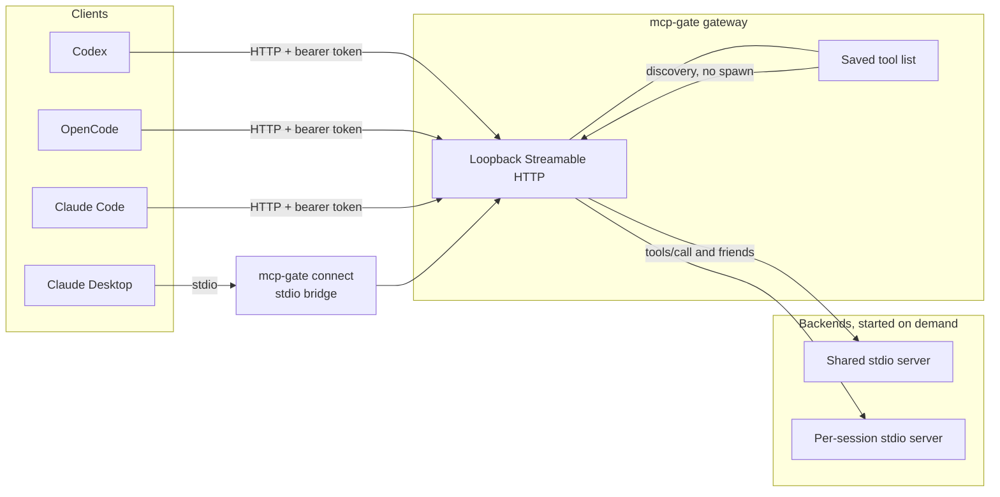

<p align="center">
  <picture>
    <source media="(prefers-color-scheme: dark)" srcset="docs/assets/mcp-gate-dark.svg">
    <source media="(prefers-color-scheme: light)" srcset="docs/assets/mcp-gate-light.svg">
    
  </picture>
</p>

<p align="center">
  <em>Local Rust gateways for the stdio MCP servers you already run.</em>
</p>

<p align="center">
  <a href="https://www.npmjs.com/package/@matvei-radchenko/mcp-gate"></a>
  <a href="https://github.com/Matvey-Radchenko/mcp-gate/releases/latest"></a>
  <a href="https://github.com/Matvey-Radchenko/mcp-gate/blob/main/LICENSE"></a>
  <a href="https://github.com/Matvey-Radchenko/mcp-gate/actions/workflows/ci.yml"></a>
</p>

**Every agent session starts its own copy of every stdio MCP server you configured, even when it only needs the tool list.** Five sessions using [Context7](https://github.com/upstash/context7) (`npx @upstash/context7-mcp`) took about 610 MB on a Linux test machine. Behind mcp-gate, the same five sessions shared one Context7 backend plus a 14 MB gateway: about 185 MB. Browser servers such as Playwright MCP keep one backend per session, started on the first browser call instead of when the session opens, and closed after 15 idle minutes.

mcp-gate puts a small Rust gateway in front of each stdio MCP server you already use in Codex, OpenCode, Claude Code, or Claude Desktop. Clients get the tool list right away from a saved copy of it, and the real server starts only when a tool is actually called.

## Quick start

1. **Connect your servers.**

   ```sh
   npx @matvei-radchenko/mcp-gate@latest setup
   ```

   `setup` lists the connections it found, lets you pick some (nothing is selected by default), and shows a preview before it changes anything.
2. **Restart each app setup lists**, once, so it picks up the new connection.
3. **Check it.**

   ```sh
   npx @matvei-radchenko/mcp-gate@latest status
   ```

   Each converted connection shows its gateway. `ready; backend idle` means the MCP server has not started yet; it starts on the first tool call.

`remove` puts the direct connections back.


Keys: type to search, arrows move, Space selects, Enter reviews, Esc goes back.

## What's new in 0.2

- **Claude Desktop** on macOS and Windows. Setup connects it through the new `mcp-gate connect` stdio bridge, which any other stdio-only client can use too.
- **`mcp-gate share` and `mcp-gate isolate`** set a gateway's ownership explicitly, with [advice](#shared-or-per-session) based on its saved tool list.
- **`max_concurrent_calls`** lets a shared backend run calls in parallel. Calls stay serial by default.
- **Windows ARM64** and **static Linux musl** builds for x64 and ARM64 (Alpine and similar).
- **Fixes:** one client cancelling a call no longer blocks a shared backend for everyone; abandoned shared HTTP sessions close after 30 minutes; loopback calls no longer wait about 40 ms for a delayed ACK; the advisor no longer flags harmless tool names.
- **`mcp-gate --version`** shows the git commit for builds from a checkout.

The full list is in the [CHANGELOG](CHANGELOG.md).

> [!IMPORTANT]
> **Upgrading from 0.1.x:** run `mcp-gate setup` once with 0.2.0, then restart the clients it lists. Setup moves everything to one fixed location so later upgrades no longer have to touch your client settings. `mcp-gate setup --dry-run` shows what will change first. [Details](docs/usage.md#upgrading-from-01x)

## Why a gateway

Three sessions and three servers mean nine processes, all started just to list tools. mcp-gate keeps one small gateway per server and starts backends only when they are used:

![The same three sessions and three servers, Context7, GitHub and Playwright, in both panels. Before: nine processes, one copy of every server per session. After: three gateways; Context7 runs one shared backend, GitHub is not started until a real call, and Playwright has a backend only for the session using it, closed when idle. Below, measured on Linux: five sessions with their own Context7 copies used about 610 MB; with mcp-gate, one shared Context7 backend plus a 14 MB gateway used about 185 MB.](docs/assets/before-after.svg)

- **Backends start on first use.** The tool list and the rest of discovery come from a saved copy. The real server starts when a call (`tools/call`, `resources/read`, `prompts/get`) needs it.
- **Shared or per-session.** A stateless server can share one backend across all clients. A server with per-client state, such as a browser, gets its own backend per session. Shared mode is opt-in; see [below](#shared-or-per-session).
- **Idle backends close.** Per-session backends close after 15 idle minutes by default; shared ones stay up unless you opt in. `mcp-gate idle <name>` changes it. [Details](docs/configurable-runtime.md#backend-idle-policy)
- **No automatic replay.** Actions are never retried or replayed. After a backend crash or a restart, sessions and unfinished work are not restored.
- **Setup does the wiring.** `setup` copies the binary to a fixed location (independent of the npx cache), registers a user service (LaunchAgent on macOS, a systemd --user unit on Linux, or a logon Task Scheduler task on Windows), checks it, and then connects the selected client entries. Names and permission settings are preserved.
- **Yours to undo.** `remove` restores direct connections. It does not delete MCP packages, user data, logs, browser artifacts, or old releases.

You still install and update MCP packages, interpreters, Docker, and browsers. Setup's discovery runs the existing command, so `npx`, `uvx`, or Docker may download their own dependencies.

### Overhead

`cargo xtask bench` measures the gateway itself against direct stdio, using an offline mock MCP server that answers instantly. One run of 0.2.0 on a Linux x86_64 cloud VM (8 vCPUs), 200 calls per client:

| Mode | Clients | p50 per call | p95 per call | First call, cold | Memory measured |
| --- | ---: | ---: | ---: | ---: | ---: |
| direct stdio | 1 | 0.04 ms | 0.04 ms | 3 ms | 5.2 MB (1 mock server) |
| direct stdio | 5 | 0.06 ms | 0.11 ms | 3 ms | 25.9 MB (5 mock servers) |
| mcp-gate shared | 1 | 0.14 ms | 0.19 ms | 16 ms | 13.8 MB (gateway only) |
| mcp-gate shared | 5 | 0.31 ms | 0.50 ms | 14 ms | 14.6 MB (gateway only) |
| mcp-gate session | 5 | 0.24 ms | 0.43 ms | 14 ms | 14.7 MB (gateway only) |

Memory is RSS after the calls. Gateway rows exclude backends: shared mode adds one mock server, session mode one per client. Cold first call includes lazy backend startup.

So a call through the gateway adds about 0.1 to 0.25 ms of loopback HTTP, and the gateway process itself stays around 14 MB whether it serves one client or five. Your real servers dominate both numbers. Method, caveats and the full table: [docs/benchmark.md](docs/benchmark.md).

## Shared or per-session

Every gateway is **session-owned** by default: each client connection gets its own backend, so browsers, tabs, cookies and other per-client state never leak between sessions. **Shared** ownership runs one backend for all clients. It saves the most memory, but is safe only for servers without per-client state, such as most API wrappers.

```sh
mcp-gate share context7 --dry-run   # show the advice and the proposed config change
mcp-gate share context7             # confirm and save shared ownership
mcp-gate isolate playwright         # back to one backend per session
```

Both commands print the gateway restart command that applies the change; run it after current actions finish. A saved choice survives tool list refreshes.

**How the advisor decides.** It reads only the gateway's saved tool list and command; it never starts the server. It recommends staying per-session if it finds any of these:

- a known per-client server: Playwright, Chrome DevTools, or Filesystem ([rules](recipes/shareability.json));
- a tool whose name changes a per-client selection, such as `select_page` or `switch_tab`. The first recognized verb decides, so `get_selected_page` does not count;
- a roots tool such as `list_allowed_directories`;
- the `resources.subscribe` capability.

Without a saved tool list it recommends per-session. Tool annotations such as `readOnlyHint` are not trusted, and finding no signal does not prove a server is safe to share. The advisor never changes anything; only a confirmed `share` or `isolate` does.

**Parallel calls.** Each backend runs one call at a time by default. For a shared backend you know handles simultaneous requests, set `max_concurrent_calls` (1 to 64) in its gateway `config.toml`; `mcp-gate share NAME --dry-run --json` prints that path:

```toml
ownership = "shared"
max_concurrent_calls = 4
```

Restart the gateway to apply it. If an overlapping call fails or times out, the gateway falls back to serial calls until it restarts. Keep browser servers such as Playwright and Chrome DevTools serial. `isolate` removes `max_concurrent_calls`. See [configurable runtime](docs/configurable-runtime.md#opt-in-to-parallel-calls).

## Claude Desktop and other stdio clients

On macOS and Windows, setup finds Claude Desktop's servers and points them at `mcp-gate connect <name>`, a small stdio bridge to the running gateway. It closes its HTTP session when the client disconnects.

Any other stdio MCP client can use the same bridge. Use `mcp-gate status` to find the gateway's name, the suffix of its `local.mcp-gate.<name>` service label. For a manually configured gateway, append `--config` and its gateway TOML path. The bridge reads the bearer token from the gateway's private token file, so the client entry needs only the command and arguments:

```json
{
  "mcpServers": {
    "context7": {
      "command": "mcp-gate",
      "args": ["connect", "context7"]
    }
  }
}
```

If the client has a different `PATH`, use the absolute path to `current/mcp-gate` in the mcp-gate state directory (`current\mcp-gate.exe` on Windows). On Windows, `setup` can replace that executable while clients are using it, and new processes launch the updated copy.

## Security model

- **Loopback only.** Each gateway listens on a loopback address with its own bearer token; a config with any other listen address is rejected. The token authorizes that one gateway only.
- **Private files.** Tokens, configs, and state live in your user's state directory with owner-only permissions (a protected DACL on Windows). No root or administrator rights are needed; services run as your user.
- **Secrets stay hidden.** Previews and `--diff` show commands, arguments and gateway URLs, never environment values, headers, or anything secret-like.
- **No surprises.** Setup changes only the connections you select, after a preview. Names and client permission settings are preserved. `remove` restores the direct connections.
- **No replay.** Actions are never retried or replayed after a crash or restart.
- **Same-user boundary.** Another program running as your user can read the token file and call the gateway, just as it could start the MCP server directly.

Report vulnerabilities as described in [SECURITY.md](SECURITY.md).

## Install

The command is `mcp-gate`; `@matvei-radchenko/mcp-gate` is only the npm package name. Release targets are **macOS ARM64 and Intel**, **Windows x64 and ARM64**, and **Linux x64 and ARM64** (glibc 2.35 or newer, or static musl).

```sh
npx @matvei-radchenko/mcp-gate@latest setup   # no install
npm i -g @matvei-radchenko/mcp-gate           # or install every command globally
```

Installing or updating the package does not switch existing connections by itself. Run `setup` from the build you want; an older build downgrades compatibly.

<details>
<summary>GitHub Release binaries, Linux services, and state</summary>

Download `mcp-gate-<version>-<target>.tar.gz` from [GitHub Releases](https://github.com/Matvey-Radchenko/mcp-gate/releases), verify it against `SHA256SUMS`, put `mcp-gate` on your `PATH`, then run `mcp-gate setup`.

State lives in `~/Library/Application Support/mcp-gate`, `%LOCALAPPDATA%\mcp-gate`, or `~/.local/share/mcp-gate`. On Linux, setup registers a `systemd --user` unit; without it, run a configured gateway with `mcp-gate serve --config <path>`.

[docs/usage.md](docs/usage.md) covers every target, Linux services, updates and downgrades, taking over a gateway you set up by hand, and all setup, remove and status options.

</details>

## Commands

| Command | What it does |
| --- | --- |
| `mcp-gate setup` | Preview and apply selected client connections, service updates, and migrations. |
| `mcp-gate status` | List client connections and `local.mcp-gate.*` user services (LaunchAgents on macOS, systemd --user units on Linux, logon tasks on Windows). `--probe` starts an idle backend to check it. |
| `mcp-gate remove` | Restore selected connections, or all managed ones with `--all --yes`. |
| `mcp-gate share <name>` | Show shareability advice and save shared backend ownership. |
| `mcp-gate isolate <name>` | Save per-session backend ownership and drop `max_concurrent_calls`. |
| `mcp-gate idle <name> [15m\|off]` | Show or set backend idle expiry. |
| `mcp-gate connect <name>` | Bridge a stdio MCP client to a running gateway. |
| `mcp-gate adopt <name>` | Register a `local.mcp-gate.<name>` service you set up by hand, so setup can manage it. |
| `mcp-gate --version` | Print the version, plus the git commit for builds from a checkout. |

`setup`, `remove`, `share`, `isolate` and `idle` support `--dry-run`, `--yes` and `--json`. `share`, `isolate` and `idle` print the restart command instead of restarting anything. For agents and scripts, see [docs/agents.md](docs/agents.md) and [docs/usage.md](docs/usage.md#non-interactive-and-agent-use).

## How it works



Each configured MCP server gets one gateway process and one authenticated loopback HTTP endpoint. Codex, OpenCode and Claude Code connect to it over HTTP. Claude Desktop and other stdio-only clients connect through `mcp-gate connect`. Remote HTTP and OAuth backends are not implemented; the upstream transport is local stdio. If a server's tool list changes after an update, the gateway stops serving it until you re-run setup and review the new list.

A reusable skill for agents lives in [`skills/mcp-gate/SKILL.md`](skills/mcp-gate/SKILL.md). Lower-level contracts are in [architecture](docs/architecture.md), [configurable runtime](docs/configurable-runtime.md), and [tool policy](docs/tool-policy.md).

## When to pick something else

mcp-gate is for one person's machine: you already run stdio MCP servers from Codex, OpenCode, Claude Code, or Claude Desktop on macOS, Windows, or Linux, and you want fewer idle processes without hand-editing client configs. It does not convert transports, connect remote or OAuth servers, or run as a multi-user cluster service. To expose a stdio server over SSE or Streamable HTTP, look at [Supergateway](https://github.com/supercorp-ai/supergateway) or [mcp-proxy](https://github.com/sparfenyuk/mcp-proxy); to plug a remote server into a stdio-only client, [mcp-remote](https://github.com/punkpeye/mcp-remote); to run and govern servers in containers or on Kubernetes, [ToolHive](https://github.com/stacklok/toolhive).

## Compatibility

Releases are published on [npm](https://www.npmjs.com/package/@matvei-radchenko/mcp-gate) and [GitHub Releases](https://github.com/Matvey-Radchenko/mcp-gate/releases). mcp-gate is used daily on macOS ARM64. Every other release target is built and tested in CI on GitHub runners: macOS Intel, Windows x64 and ARM64, Ubuntu 22.04 x64 and ARM64, and Alpine containers for the musl builds. Reports from Intel Macs, Windows, and Linux desktops are welcome. Built-in sharing presets for known servers currently apply to macOS ARM64 only; elsewhere, use `mcp-gate share`. Tested client versions and remaining gaps: [docs/compatibility.md](docs/compatibility.md).

## FAQ

**Why is the package called `@matvei-radchenko/mcp-gate` but the command is `mcp-gate`?**
The scoped npm name is the package. The executable — what clients invoke — is `mcp-gate`. A GitHub Release binary provides the same command.

**Does setup touch my project repo?**
Setup converts only the connections you select in your personal settings or machine-local overrides. Shared project files are never rewritten.

**Will my browser / API sessions come back after a reboot?**
No. Sessions and unfinished actions are not restored after restart. A new session starts a fresh backend.

**Do I still have to update Playwright, Chrome DevTools, Docker, and so on?**
Yes. mcp-gate does not install or update servers or their dependencies. Built-in sharing presets match exact versions and commands; a server name alone never turns on shared mode.

**I already point a client at some other gateway.**
`status` reports that connection as `external`. This installation will not take it over or rename it automatically.

**Does it work with Cursor, VS Code, or Windsurf?**
Setup does not detect them yet. Any stdio MCP client can still use a gateway that setup created for another client, through `mcp-gate connect`. For example, in Cursor's `mcp.json`:

```json
{
  "mcpServers": {
    "context7": { "command": "mcp-gate", "args": ["connect", "context7"] }
  }
}
```

VS Code uses `"servers"` with `"type": "stdio"` and the same `command` and `args`. Use `mcp-gate status` to see gateway names.

**Can I script this from an agent?**
Yes — with `--json`, `--dry-run`, and explicit `--yes` only after the user has chosen the targets. See [docs/agents.md](docs/agents.md).

**Can another agent on this machine call a gateway?**
Each configured server has its own loopback Streamable HTTP endpoint and its own bearer token. Another agent on the same machine can call that endpoint. The token authorizes that gateway only.

## Development

See [CONTRIBUTING.md](CONTRIBUTING.md).

```sh
cargo xtask check
```

This runs formatting, strict Clippy, source-size budgets, and ordinary fixture/unit tests. GitHub CI runs the full test suite on every release platform and verifies a clean npm installation.

## License

MIT. Issues and reports are welcome, especially from Intel Macs, Windows, and Linux desktops.
