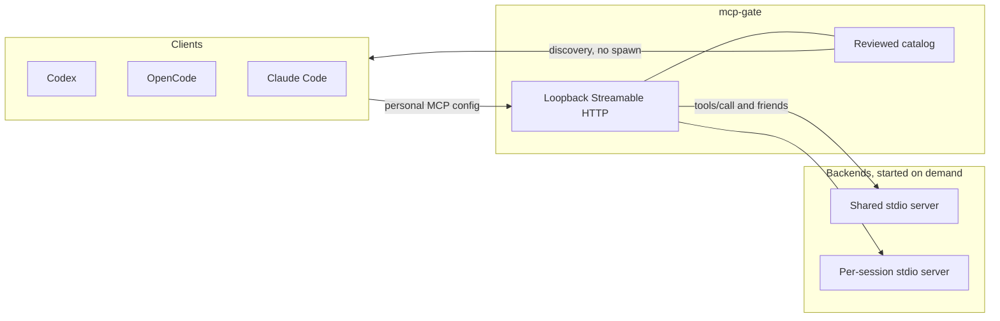

<p align="center">
  <!-- TODO: add a dark/light wordmark. Until then the typographic heading is enough. -->
  <!--
  <picture>
    <source media="(prefers-color-scheme: dark)" srcset="docs/assets/mcp-gate-dark.svg">
    <source media="(prefers-color-scheme: light)" srcset="docs/assets/mcp-gate-light.svg">
    
  </picture>
  -->
</p>

<h1 align="center">mcp-gate</h1>

<p align="center">
  <em>Local Rust gateways for the stdio MCP servers you already run.</em>
</p>

<p align="center">
  <a href="https://www.npmjs.com/package/@matvei-radchenko/mcp-gate"></a>
  <a href="https://github.com/Matvey-Radchenko/mcp-gate/releases/latest"></a>
  <a href="https://github.com/Matvey-Radchenko/mcp-gate/blob/main/LICENSE"></a>
  <a href="https://github.com/Matvey-Radchenko/mcp-gate/actions/workflows/ci.yml"></a>
</p>

Discovery stays available while backends start on demand. Verified stateless API servers can share a single serialized backend; session-owned servers keep independent MCP connections. Setup rewrites personal Codex, OpenCode, and Claude Code connections so those apps talk to the gateway, then leaves the MCP packages themselves alone.

```sh
npx @matvei-radchenko/mcp-gate@latest setup
```

In a terminal, `setup` and `remove` ask you to choose connections and show a preview before changing anything. Type to search, arrows move, Space selects, Enter reviews, Esc goes back. Nothing is selected by default.

<!-- TODO: record a short GIF or asciinema of the setup wizard and put it here, e.g.  -->

## Why a gateway

A stdio MCP server that starts with the client starts on every session, even when you only needed the tool catalog. mcp-gate sits in front as a small Rust process:

- **Lazy backends.** `initialize`, `tools/list`, and the rest of discovery are served from a reviewed catalog snapshot. The upstream process starts when a real call (`tools/call`, `resources/read`, `prompts/get`) needs it.
- **Shared or session-owned.** A reviewed stateless API can share one serialized backend across clients. A session-owned server (browsers, anything with per-client state) gets its own MCP connection. Shared mode is opt-in and is not safe for an arbitrary browser server.
- **Idle session workers.** A session-owned backend closes after 15 minutes with no request and no open GET stream (`session_idle_seconds`, default 900), which frees its worker. If the process exits, the slot is released immediately. When every slot is busy, the longest-idle session that has already been idle for 2 minutes (`session_idle_evict_seconds`, default 120) is stopped so a new call can start. A running call is not evicted. Shared backends are not closed for being idle.
- **No automatic replay.** Actions are never retried or replayed. After a backend crash or a restart, sessions and unfinished work are not restored.
- **Managed client setup.** `setup` copies the binary into permanent versioned storage (independent of the npx cache), registers a user service (LaunchAgent on macOS, a logon Task Scheduler task on Windows), checks readiness, and only then changes personal client connections. Names and permission settings are preserved. Project files intended for Git are left untouched.
- **Yours to undo.** `remove` restores direct connections. It does not delete MCP packages, user data, logs, browser artifacts, or old releases.

You still install and update MCP packages, interpreters, Docker, and browsers. Setup's discovery runs the existing command, so `npx`, `uvx`, or Docker may download their own dependencies.

## How it works



Each configured MCP gets one gateway process and one authenticated loopback HTTP endpoint. Clients connect directly; there is no per-client stdio adapter. Remote HTTP and OAuth backends are not implemented. The upstream transport is local stdio.

One request runs at a time per backend. Catalog drift fails closed until you regenerate and review the snapshot. A reusable skill for agents lives in [`skills/mcp-gate/SKILL.md`](skills/mcp-gate/SKILL.md). Lower-level contracts are in [architecture](docs/architecture.md), [configurable runtime](docs/configurable-runtime.md), and [tool policy](docs/tool-policy.md).

## Install

The installed command is `mcp-gate`. Codex, OpenCode, and Claude Code invoke that executable. The scoped npm name is the package, not the command. Installing or updating the npm package does not switch existing connections. Run `setup` (or `setup` of an older build, to downgrade compatibly).

Release targets are **macOS ARM64**, **macOS Intel**, and **Windows x64**. Linux is not included.

<details>
<summary>npm (recommended)</summary>

```sh
npx @matvei-radchenko/mcp-gate@latest setup
npx @matvei-radchenko/mcp-gate@latest status
npx @matvei-radchenko/mcp-gate@latest remove
```

Or install the launcher globally. It provides the same three commands, plus `adopt`:

```sh
npm i -g @matvei-radchenko/mcp-gate
mcp-gate setup
```

The scoped packages are `@matvei-radchenko/mcp-gate` and the platform binaries `@matvei-radchenko/mcp-gate-bin-darwin-arm64`, `@matvei-radchenko/mcp-gate-bin-darwin-x64`, and `@matvei-radchenko/mcp-gate-bin-win32-x64`.

</details>

<details>
<summary>GitHub Release binary</summary>

Download the archive for your platform from the [GitHub Releases](https://github.com/Matvey-Radchenko/mcp-gate/releases) page (`mcp-gate-*-darwin-arm64.tar.gz`, `*-darwin-x64.tar.gz`, or `*-win32-x64.tar.gz`) and verify it against the attached `SHA256SUMS`. Put `mcp-gate` on your `PATH`, then run `mcp-gate setup`.

</details>

State lives in `~/Library/Application Support/mcp-gate` or `%LOCALAPPDATA%\mcp-gate`. Gateways start after login; MCP backends stay lazy.

Run `setup` again with a newer or older build to update compatible background services. An idle service enters maintenance before replacement; a busy service waits until a later setup. Unsupported state formats are rejected. Operation journals keep recoverable changes and do not overwrite later edits.

## Everyday commands

| Command | What it does |
| --- | --- |
| `mcp-gate setup` | Preview, then register services and rewrite selected personal client connections. |
| `mcp-gate status` | List client connections. On macOS, also list `local.mcp-gate.*` LaunchAgents. |
| `mcp-gate remove` | Restore selected connections, or all managed ones with `--all --yes`. |
| `mcp-gate adopt <name>` | Record an unmanaged `local.mcp-gate.<name>` LaunchAgent in the local registry. Does not restart the gateway, edit client settings, or copy the binary. |

`setup --dry-run` previews selected settings without launching a backend or writing files. `--client`, `--server`, and `--project` narrow the selection. `--yes` requires both an explicit client and server, except `remove --all`. `--diff` shows a structural diff with values hidden. `--json` writes a versioned result to stdout; diagnostics go to stderr.

`status --details` explains sources. `status --probe` requests backend initialization only when the gateway can safely enter maintenance and has no existing backend; busy gateways are deferred. A connection kind of `external` means the client already uses a gateway this installation did not set up, so `setup` and `remove` do not own it. A healthy gateway alone does not prove that a running application has switched to it.

Each affected application needs one restart after `setup`. Claude local scope can override a selected project through personal settings; other project entries without a verified local override are skipped, as are commands with unresolved working directories or environment expansion.

<details>
<summary>Non-interactive / agent use</summary>

Non-interactive use never prompts. Pass `--json` for one JSON document on stdout, and `--dry-run` to preview. Applying changes from an agent requires explicit `--client` and `--server` with `--yes`, or `remove --all --yes`. Argument errors are JSON when `--json` is present. Follow [docs/agents.md](docs/agents.md).

```sh
mcp-gate status --json
mcp-gate setup --dry-run --json
mcp-gate setup --client codex --server NAME --yes --json
mcp-gate remove NAME --dry-run
mcp-gate adopt NAME --dry-run
```

Do not pass `--yes` unless the user has already chosen the exact clients and servers. If a command may already have changed client settings, inspect `status --json` before running it again.

</details>

## Compared with other MCP gateways

mcp-gate is a **local** process manager and client-config helper for **existing stdio** servers. It is not a transport converter, a remote OAuth shim, or an enterprise control plane.

| | mcp-gate | [Supergateway](https://github.com/supercorp-ai/supergateway) / [mcp-proxy](https://github.com/sparfenyuk/mcp-proxy) | [mcp-remote](https://github.com/punkpeye/mcp-remote) | [ToolHive](https://github.com/stacklok/toolhive) |
| --- | --- | --- | --- | --- |
| Job | Lazy local Rust frontends, catalog discovery, managed setup for Codex / OpenCode / Claude Code | Bridge between stdio and SSE, WebSocket, or Streamable HTTP | Plug a remote MCP server into a stdio-only client, including OAuth | Run and govern MCP servers in containers, on the desktop, or on Kubernetes |
| Upstream | Local stdio only | Local command or a remote URL | Remote HTTP / SSE | Images, packages, or remote servers |
| Client config | `setup` / `remove` edit personal settings; Git project files are left alone | You paste a command or URL into the client | You paste an `npx mcp-remote ...` command into the client | Desktop app or CLI can attach clients |
| Linux | Not a release target | Yes | Yes | Yes |

## Compatibility

0.1.0 is published on npm and as [GitHub Release v0.1.0](https://github.com/Matvey-Radchenko/mcp-gate/releases/tag/v0.1.0). Native login acceptance is **macOS ARM64 only**. The Intel x86_64 check under Rosetta 2 has not been run; Windows x64 was smoke-tested under Wine, not on a native Windows login. Stability on native Intel Macs and Windows is not guaranteed, and reports are welcome.

CI runs formatting, Clippy, fixtures, and client/browser checks on all three release platforms; that is not the same thing as a native login test. The evidence table, tested client versions, and recipe constraints are in [docs/compatibility.md](docs/compatibility.md). Automatic shared-ownership recipes currently carry reviewed `macos-aarch64` conditions only.

## FAQ

**Why is the package called `@matvei-radchenko/mcp-gate` but the command is `mcp-gate`?**
The scoped npm name is the package. The executable — what clients invoke — is `mcp-gate`. A GitHub Release binary provides the same command.

**Does setup touch my project repo?**
Project files intended for Git are left untouched. Only personal client connections that you select are rewritten, after a preview.

**Will my browser / API sessions come back after a reboot?**
No. Sessions and unfinished actions are not restored after restart. A new session starts a fresh backend.

**Do I still have to update Playwright, Chrome DevTools, Docker, and so on?**
Yes. mcp-gate does not analyze or copy arbitrary dependency trees. Reviewed recipes use narrow version and invocation conditions; a name alone never selects shared mode.

**I already point a client at some other gateway.**
`status` reports that connection as `external`. This installation will not adopt or rename it automatically. Old `mcp-session-gateway` configurations remain readable.

**Can I script this from an agent?**
Yes — with `--json`, `--dry-run`, and explicit `--yes` only after the user has chosen the targets. See [docs/agents.md](docs/agents.md).

## Development

See [CONTRIBUTING.md](CONTRIBUTING.md).

```sh
cargo xtask check
```

This runs formatting, strict Clippy, source-size budgets, and ordinary fixture/unit tests. GitHub CI runs native checks on all three release platforms and verifies a clean npm archive installation. A workflow definition is not evidence that its acceptance runs passed.

## License

MIT. Issues and reports are welcome, including from Intel Mac and Windows logins that 0.1.0 has not fully accepted yet.
